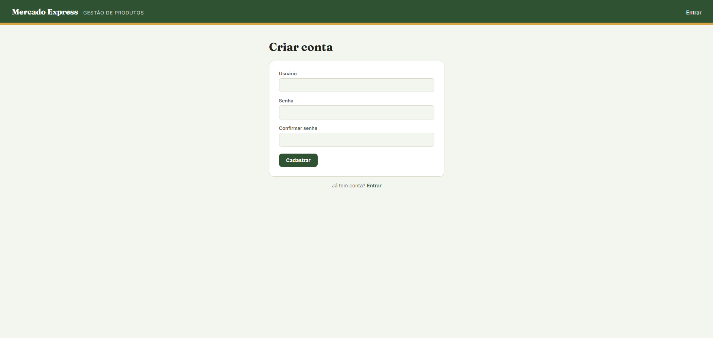
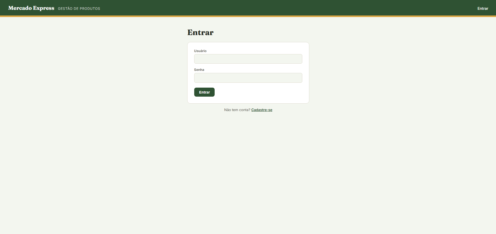
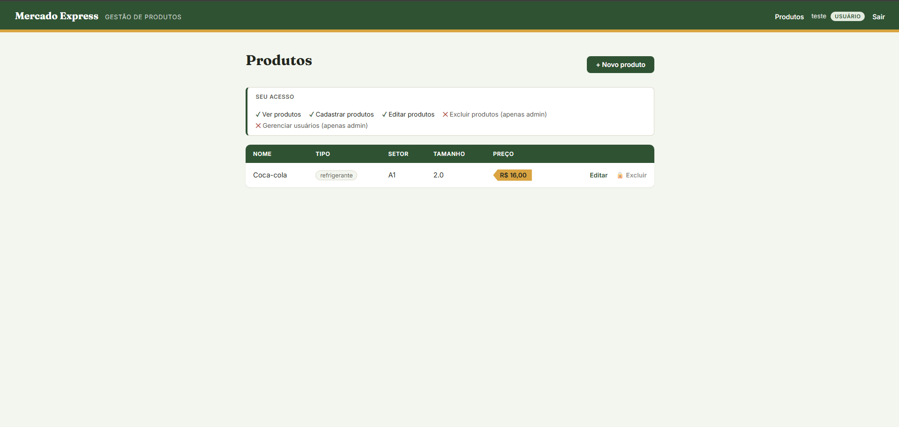
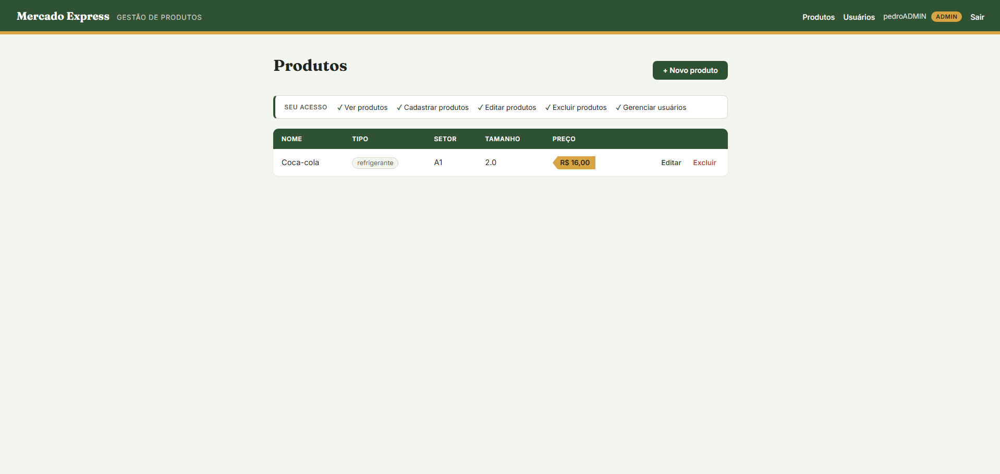
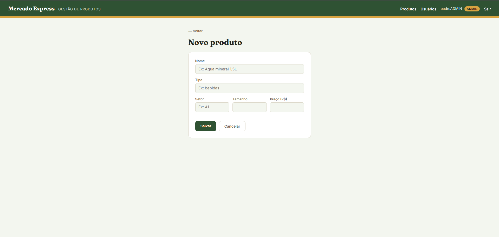
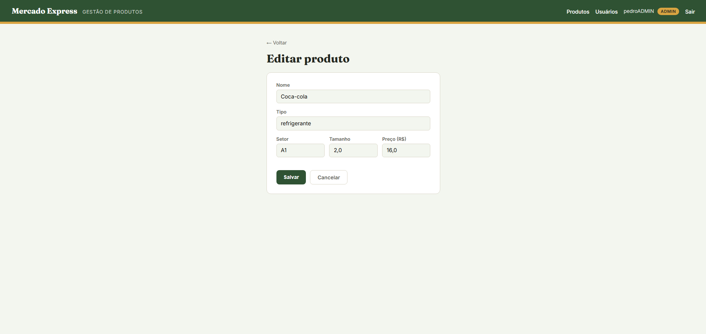
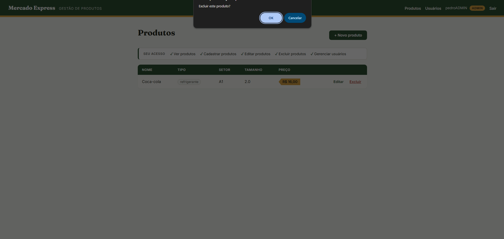

# Mercado Express — Checkpoint 5 (Parte 1)

Aplicação **Spring Boot** para gestão de produtos de um mercado express (ex: meias, produtos de limpeza, frutas), com **API REST**, **interface Web em Thymeleaf**, persistência em **Oracle** e **controle de acesso por perfil de usuário** com Spring Security.

Este checkpoint evolui o projeto construído nas entregas anteriores. As principais novidades são:

- Configuração migrada de `application.properties` para **`application.yaml`**.
- **Dois perfis de usuário** (`ADMIN` e `USER`) com permissões diferentes.
- **Área administrativa** para gerenciar usuários e seus perfis.
- Interface reformulada para deixar **visível o que cada usuário pode ou não fazer**.
- Página própria de **acesso negado (403)**.

**IDE utilizada:** IntelliJ IDEA

## Link Render
`https://checkpoint05-java-parte1.onrender.com`

## Sumário

- [O que foi feito neste checkpoint](#o-que-foi-feito-neste-checkpoint)
- [Tecnologias utilizadas](#tecnologias-utilizadas)
- [Arquitetura](#arquitetura)
- [Estrutura do projeto](#estrutura-do-projeto)
- [Modelo de dados](#modelo-de-dados)
- [Configuração (`application.yaml`)](#configuração-applicationyaml)
- [Perfis de usuário e permissões](#perfis-de-usuário-e-permissões)
- [Autenticação e segurança](#autenticação-e-segurança)
- [Interface Web](#interface-web)
- [Telas da aplicação](#telas-da-aplicação)
- [API REST](#api-rest)
- [Como executar o projeto](#como-executar-o-projeto)
- [Como criar o primeiro administrador](#como-criar-o-primeiro-administrador)
- [Roteiro de teste](#roteiro-de-teste)

## O que foi feito neste checkpoint

| Item | Antes | Agora |
|---|---|---|
| Arquivo de configuração | `application.properties` | `application.yaml`, com credenciais do banco lidas de variáveis de ambiente |
| Usuários | Um único tipo de usuário autenticado | Dois perfis: `ADMIN` e `USER` |
| Exclusão de produtos | Qualquer usuário logado | Apenas `ADMIN` (na tela e na API REST) |
| Gestão de usuários | Não existia | Tela `/admin/usuarios` para promover, rebaixar e excluir usuários |
| Visibilidade das permissões | Nenhuma indicação | Selo de perfil no cabeçalho, painel "Seu acesso" e botão de exclusão bloqueado para quem não tem permissão |
| Acesso negado | Página de erro padrão do Spring | Página 403 personalizada |

## Tecnologias utilizadas

| Tecnologia | Finalidade |
|---|---|
| Java | Linguagem principal |
| Spring Boot | Framework da aplicação |
| Spring Web | Endpoints REST e roteamento das páginas |
| Spring Data JPA / Hibernate | Persistência no Oracle |
| Spring HATEOAS | Links de navegação na API REST (nível 3 de maturidade) |
| Spring Security | Autenticação por formulário, sessão e autorização por perfil |
| BCrypt | Hash das senhas |
| Thymeleaf + Thymeleaf Extras Spring Security | Renderização das páginas HTML e exibição condicional por perfil |
| Bean Validation | Validação dos dados de entrada da API |
| Lombok | Redução de boilerplate |
| Maven | Build e dependências |
| Oracle Database | Banco de dados relacional |
| Tomcat embutido | Servidor da aplicação (porta 8082) |

## Arquitetura

A aplicação segue arquitetura em camadas. A API REST e a interface Web têm controllers separados, mas compartilham a mesma camada de negócio. Nenhuma regra de negócio é duplicada.

```
Navegador (HTML)                 Postman / Insomnia (JSON)
       |                                   |
MercadoViewController             MercadoController
UsuarioAdminController                     |
AutenticacaoController                     |
       |                                   |
       +-------------> MercadoService <----+
                             |
               MercadoRepository / UsuarioRepository
                             |
                       Oracle Database
```

O Spring Security atua antes dos controllers, como um filtro. Cada requisição é checada contra as regras de acesso antes de chegar ao código da aplicação.

## Estrutura do projeto

```
src/main/java/br/com/mercadoexpress
├── domain/mercado
│   ├── Mercado.java
│   └── MercadoAssembler.java
├── domain/usuario
│   ├── Usuario.java
│   └── Perfil.java                    (novo: enum ADMIN / USER)
├── controller
│   └── MercadoController.java         (API REST)
├── web
│   ├── MercadoViewController.java     (páginas de produtos)
│   ├── MercadoFormData.java
│   ├── AutenticacaoController.java    (login e cadastro)
│   ├── CadastroForm.java
│   └── UsuarioAdminController.java    (novo: área do administrador)
├── security
│   ├── SecurityConfig.java
│   └── AutenticacaoService.java
├── service
│   └── MercadoService.java
├── repository
│   ├── MercadoRepository.java
│   └── UsuarioRepository.java
├── dto/request
│   └── MercadoRequest.java
├── dto/response
│   └── MercadoResponse.java
├── exception
│   ├── GlobalExceptionHandler.java
│   └── IdNaoEncontradoException.java
└── config
    └── CorsConfig.java

src/main/resources
├── application.yaml                   (novo: substitui o .properties)
├── templates
│   ├── fragments/layout.html
│   ├── mercado/list.html
│   ├── mercado/form.html
│   ├── auth/login.html
│   ├── auth/cadastro.html
│   ├── admin/usuarios.html            (novo)
│   └── error/403.html                 (novo)
└── static
    ├── css/mercado.css
    └── js/cadastro.js
```

## Modelo de dados

Todas as tabelas seguem o prefixo `TDS_TB_05_`, definido para este checkpoint.

**Tabela `TDS_TB_05_mercado`**

| Coluna | Tipo Java | Observação |
|---|---|---|
| ID | Long | Chave primária gerada automaticamente (`IDENTITY`) |
| NOME | String | Obrigatório, até 50 caracteres |
| TIPO | String | Obrigatório, até 50 caracteres |
| SETOR | String | Opcional |
| TAMANHO | Double | Opcional |
| PRECO | Double | Obrigatório |

**Tabela `TDS_TB_05_usuarios_mercado`**

| Coluna | Tipo Java | Observação |
|---|---|---|
| ID | Long | Chave primária gerada automaticamente (`IDENTITY`) |
| USERNAME | String | Único, até 50 caracteres |
| SENHA | String | Hash BCrypt, nunca a senha em texto puro |
| PERFIL | Perfil (enum) | Novo neste checkpoint. Gravado como texto (`ADMIN` ou `USER`) |

O perfil é salvo com `@Enumerated(EnumType.STRING)`, e não como número (`ORDINAL`). Com `ORDINAL`, o banco guardaria a posição do valor no enum (0, 1), e qualquer reordenação futura do enum trocaria silenciosamente o perfil de todos os usuários já cadastrados.

## Configuração (`application.yaml`)

A configuração foi migrada para YAML, que organiza as propriedades por hierarquia em vez de repetir prefixos:

```yaml
spring:
  application:
    name: mercadoexpress
  datasource:
    url: ${DB_URL}
    username: ${DB_USERNAME}
    password: ${DB_PASSWORD}
    driver-class-name: oracle.jdbc.OracleDriver
  jpa:
    hibernate:
      ddl-auto: update
    show-sql: true
    properties:
      hibernate:
        format_sql: true
        dialect: org.hibernate.dialect.OracleDialect

server:
  port: 8082
```

As credenciais do banco não ficam escritas no arquivo. Elas são lidas das variáveis de ambiente `DB_URL`, `DB_USERNAME` e `DB_PASSWORD`, o que evita que senhas sejam publicadas no repositório.

O antigo `application.properties` foi removido. Se os dois arquivos coexistirem, o Spring carrega ambos e o `.properties` tem precedência, o que pode fazer alterações no YAML parecerem ignoradas.

## Perfis de usuário e permissões

| Ação | `USER` | `ADMIN` |
|---|---|---|
| Ver produtos | ✅ | ✅ |
| Cadastrar produtos | ✅ | ✅ |
| Editar produtos | ✅ | ✅ |
| Excluir produtos | ❌ | ✅ |
| Acessar a área de usuários | ❌ | ✅ |
| Promover, rebaixar e excluir usuários | ❌ | ✅ |

**Regras de negócio da área administrativa:**

- Todo cadastro feito pela tela pública `/cadastro` recebe o perfil `USER`. O perfil é definido no servidor e não existe campo para escolhê-lo no formulário, então ninguém consegue se cadastrar como administrador.
- Um administrador não pode alterar o próprio perfil nem excluir a própria conta. Isso evita que o único administrador perca o acesso à área de gestão por engano.
- A alteração de perfil passa a valer no próximo login do usuário afetado, porque as permissões são carregadas na sessão no momento da autenticação.

## Autenticação e segurança

A segurança usa **Spring Security com login por formulário e sessão**.

1. No cadastro, a senha passa pelo `BCryptPasswordEncoder` antes de ser salva. O hash não é reversível.
2. No login, a classe `AutenticacaoService` (que implementa `UserDetailsService`) busca o usuário no banco e informa ao Spring Security o seu perfil através de `roles(...)`. Isso gera a autoridade `ROLE_ADMIN` ou `ROLE_USER`.
3. O Spring Security compara o hash da senha digitada com o hash salvo e, se bater, cria a sessão autenticada.

**Regras de acesso (`SecurityConfig`)**, avaliadas de cima para baixo:

| Rota | Regra |
|---|---|
| `/login`, `/cadastro`, `/css/**`, `/js/**`, `/error` | Públicas |
| `/admin/**` | Apenas `ADMIN` |
| `POST /mercados/{id}/excluir` | Apenas `ADMIN` |
| `DELETE /mercado/**` (API REST) | Apenas `ADMIN` |
| Qualquer outra rota | Exige login |

**Por que a restrição está no servidor e não só na tela:** na interface, o botão de exclusão aparece bloqueado para o `USER`. Isso é apenas experiência de uso. A segurança real está no `SecurityConfig`: mesmo que alguém envie a requisição de exclusão diretamente (pelo Postman, por exemplo), o servidor responde com 403. Por isso a regra também cobre o `DELETE` da API REST.

**Outras proteções:**

- **CSRF:** ativado por padrão. O Thymeleaf injeta o token automaticamente em todos os formulários com `th:action`.
- **Validação de cadastro em duas camadas:** `cadastro.js` dá retorno imediato no navegador, e o `AutenticacaoController` repete as verificações (senhas iguais, usuário não duplicado), já que o JavaScript pode ser desativado.

## Interface Web

### Páginas

| Rota | Página | Acesso |
|---|---|---|
| `/cadastro` | Criação de conta | Público |
| `/login` | Login | Público |
| `/mercados` | Listagem de produtos com painel de permissões | Logado |
| `/mercados/novo` | Cadastro de produto | Logado |
| `/mercados/{id}/editar` | Edição de produto | Logado |
| `/admin/usuarios` | Gestão de usuários | `ADMIN` |
| Qualquer rota sem permissão | Página "Acesso negado" (403) | — |

### Operações de CRUD na interface

Todas as operações do CRUD de produtos aparecem na tela como links ou botões, sem precisar digitar endereços:

| Operação | Elemento na tela | Requisição gerada | Onde fica |
|---|---|---|---|
| **Create** | Botão "+ Novo produto" e botão "Salvar" do formulário | `GET /mercados/novo` e `POST /mercados` | Topo da listagem |
| **Read** | Tabela de produtos | `GET /mercados` | Página principal |
| **Update** | Link "Editar" e botão "Salvar" do formulário | `GET /mercados/{id}/editar` e `POST /mercados/{id}/atualizar` | Cada linha da tabela |
| **Delete** | Botão "Excluir", com confirmação | `POST /mercados/{id}/excluir` | Cada linha da tabela (apenas `ADMIN`) |

As operações de atualizar e excluir usam `POST` porque formulários HTML só enviam `GET` e `POST` nativamente. Cada uma tem uma rota própria, para não haver ambiguidade entre elas.

Em todas as operações, o `MercadoViewController` chama o `MercadoService`, que consulta ou grava na tabela `TDS_TB_05_mercado` do Oracle. Depois de criar, editar ou excluir, a aplicação redireciona para a listagem, que é recarregada do banco com o resultado.

### Como a interface mostra as permissões

- **Cabeçalho:** exibe o nome do usuário logado e um selo com o perfil (`Admin` ou `Usuário`). O link "Usuários" só aparece para administradores.
- **Painel "Seu acesso":** na listagem de produtos, uma faixa lista cada ação com ✓ (permitida) ou ✕ (restrita a administradores), de acordo com o perfil logado.
- **Botão de exclusão:** para o `ADMIN`, funciona normalmente com confirmação. Para o `USER`, aparece como "🔒 Excluir", desabilitado, com a dica "Apenas administradores podem excluir".
- **Área do administrador:** lista todos os usuários com seu perfil, permite alternar entre `ADMIN` e `USER` e excluir contas. A linha do próprio administrador logado aparece marcada como "(você)", sem ações.
- **Página 403:** se um `USER` tentar acessar uma rota restrita digitando o endereço, vê uma página explicando que a área é exclusiva de administradores, com um botão para voltar aos produtos.

A exibição condicional é feita com o atributo `sec:authorize` do Thymeleaf Extras Spring Security (por exemplo, `sec:authorize="hasRole('ADMIN')"`).

### Design

CSS próprio, sem framework externo:

- **Cores:** verde-mata (`#2F5233`) como cor principal e mostarda (`#D9A441`) como destaque, usada também no selo de administrador.
- **Tipografia:** `Fraunces` nos títulos e `Inter` no restante.
- **Elemento de assinatura:** o preço é exibido como uma etiqueta recortada em CSS (`clip-path`), lembrando uma tag de preço física.
- **Responsivo:** tabela, formulários e painel se adaptam a telas menores.

## API REST

A API REST continua disponível em `/mercado`, com retorno no padrão HATEOAS (nível 3 de maturidade de Richardson). Todos os endpoints exigem login, e a exclusão exige perfil `ADMIN`.

| Método | Endpoint | Descrição | Perfil |
|---|---|---|---|
| POST | `/mercado` | Cria um produto | `USER` ou `ADMIN` |
| GET | `/mercado` | Lista produtos paginados, com links de paginação | `USER` ou `ADMIN` |
| GET | `/mercado/{id}` | Busca um produto pelo ID | `USER` ou `ADMIN` |
| PUT | `/mercado/{id}` | Atualiza um produto | `USER` ou `ADMIN` |
| DELETE | `/mercado/{id}` | Remove um produto | `ADMIN` |

**Respostas de erro:**

| Situação | Status |
|---|---|
| Dados inválidos no corpo da requisição | 400, com a lista de campos e mensagens |
| JSON malformado | 400 |
| Produto não encontrado | 404 |
| Usuário sem permissão para a operação | 403 |

**Testando pelo Postman/Insomnia:** como a API exige sessão, é preciso autenticar primeiro com um `POST /login` enviando `username` e `password` como dados de formulário (`x-www-form-urlencoded`). O cliente guarda o cookie de sessão retornado e o reutiliza nas requisições seguintes.

## Como executar o projeto

1. Clone o repositório:
   ```bash
   git clone <url-do-repositorio>
   ```
2. Defina as variáveis de ambiente do banco (no IntelliJ: *Run > Edit Configurations > Environment variables*):
   ```
   DB_URL=jdbc:oracle:thin:@<host>:<porta>/<servico>
   DB_USERNAME=<usuario>
   DB_PASSWORD=<senha>
   ```
3. Rode a aplicação:
   ```bash
   mvn spring-boot:run
   ```
4. Acesse `http://localhost:8082/cadastro` e crie uma conta.

As tabelas são criadas e atualizadas automaticamente pelo Hibernate (`ddl-auto: update`).

## Como criar o primeiro administrador

Como o cadastro público sempre cria usuários com perfil `USER`, o primeiro administrador é promovido diretamente no banco:

1. Cadastre-se normalmente pela tela `/cadastro`.
2. No SQL Developer, execute:
   ```sql
   UPDATE TDS_TB_05_usuarios_mercado SET perfil = 'ADMIN' WHERE username = 'seu_usuario';
   COMMIT;
   ```
   O `COMMIT` é obrigatório. Sem ele, a alteração fica só na sessão do SQL Developer e a aplicação não a enxerga.
3. Faça logout e login novamente para o novo perfil entrar em vigor.

A partir daí, os demais administradores podem ser promovidos pela própria tela `/admin/usuarios`.

## Telas da aplicação

As capturas ficam na pasta `docs/images/` do repositório.

### 1. Cadastro de usuário



Tela pública de criação de conta. O formulário pede usuário, senha e confirmação da senha. O `cadastro.js` avisa no próprio navegador se a senha tiver menos de 6 caracteres ou se as senhas não coincidirem. Toda conta criada aqui recebe o perfil `USER`.

### 2. Login



Tela pública de autenticação. Em caso de usuário ou senha inválidos, uma mensagem de erro é exibida. Após o cadastro ou o logout, aparece uma mensagem de confirmação.

### 3. Listagem de produtos como `USER` (Read)



Página principal, carregada a partir da tabela `TDS_TB_05_mercado`. O cabeçalho mostra o usuário logado com o selo "Usuário". O painel "Seu acesso" indica que a exclusão e a gestão de usuários são restritas, e o botão de exclusão aparece bloqueado com cadeado.

### 4. Listagem de produtos como `ADMIN` (Read)



A mesma página vista por um administrador. O selo muda para "Admin", o link "Usuários" aparece no cabeçalho, o painel mostra todas as ações como permitidas e o botão "Excluir" fica ativo.

### 5. Novo produto (Create)



Formulário aberto pelo botão "+ Novo produto". Ao clicar em "Salvar", o produto é gravado no banco e o usuário volta para a listagem, já com o novo item.

### 6. Edição de produto (Update)



Formulário aberto pelo link "Editar", já preenchido com os dados atuais do produto. Ao salvar, o registro é atualizado no banco.

### 7. Exclusão de produto (Delete)



Ao clicar em "Excluir", o navegador pede confirmação. Confirmando, o produto é removido do banco e some da listagem.

## Roteiro de teste

Para comparar os dois perfis lado a lado, use duas janelas de navegador (uma normal e uma anônima), cada uma logada com um perfil.

**Como `USER`:**
1. Acessar `/mercados` sem login e confirmar o redirecionamento para `/login`.
2. Fazer login e verificar o selo "Usuário" no cabeçalho e o painel "Seu acesso" com exclusão e gestão de usuários marcadas como restritas.
3. Cadastrar e editar um produto com sucesso.
4. Confirmar que o botão de exclusão aparece bloqueado.
5. Digitar `/admin/usuarios` na barra de endereço e confirmar a página "Acesso negado".

**Como `ADMIN`:**
1. Fazer login e verificar o selo "Admin" e o link "Usuários" no cabeçalho.
2. Excluir um produto.
3. Em `/admin/usuarios`, promover um `USER` a `ADMIN` e depois rebaixá-lo.
4. Confirmar que a própria linha aparece como "(você)", sem ações disponíveis.
5. Excluir um usuário de teste.